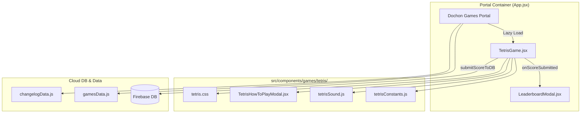

# Dochon Tetris (도촌 테트리스) Implementation Plan

> **For agentic workers:** REQUIRED SUB-SKILL: Use superpowers:subagent-driven-development to implement this plan task-by-task. Steps use checkbox (`- [ ]`) syntax for tracking.

**Goal:** Integrate the cloned game 'tetris-for-everyone' into Dochon Games Portal as a native React game in a dedicated folder (`src/components/games/tetris/`), fully wired to the Cloud DB Leaderboard and Portal UI.

**Architecture:** The game is modularized into independent files within `src/components/games/tetris/`. `tetrisConstants.js` defines tetromino shapes and scoring rules. `tetrisSound.js` synthesizes the classic 8-bit Korobeiniki theme and SFX with the Web Audio API. `TetrisGame.jsx` orchestrates the game loop, ghost piece rendering, touch/keyboard controls, game over overlay, and the Hall of Fame submission. Finally, `gamesData.js`, `App.jsx`, and `changelogData.js` are updated to register the game into Dochon Games Portal.

**Architecture Diagram:**



**Tech Stack:** React 18, HTML5 Canvas 2D, Web Audio API, Lucide React, Tailwind CSS / Vanilla CSS, Firebase Realtime DB.

## Global Constraints
- **Dedicated Folder Rule**: All game files MUST reside in `src/components/games/tetris/`.
- **100-Point Rule**: Score submission input and button MUST be hidden when `score <= 100`. Only visible when `score > 100`.
- **Placeholder Rule**: Leaderboard input placeholder MUST strictly be `'예: 홍길동'`.
- **Leaderboard Auto-Sync**: On successful submission, call `onScoreSubmitted()` which opens `LeaderboardModal` with the `tetris` tab active.
- **Changelog Rule**: Release note in `src/data/changelogData.js` dated `2026-10-11` using education-friendly wording (no "school network" or bypass terminology, no credentials).

---

### Task 1: Create Game Constants & Configurations (`tetrisConstants.js`)

**Files:**
- Create: `src/components/games/tetris/tetrisConstants.js`

**Interfaces:**
- Produces: `PIECES`, `COLORS`, `BOARD_WIDTH`, `BOARD_HEIGHT`, `BLOCK_SIZE`, `CALCULATE_SCORE`, `GET_DROP_SPEED`

- [ ] **Step 1: Write `tetrisConstants.js`**
Define matrix shapes for standard tetrominoes (I, J, L, O, S, T, Z), arcade color palette, grid dimensions (12 columns, 20 rows), scoring table, and level-based speed intervals.

```javascript
// src/components/games/tetris/tetrisConstants.js

export const BOARD_WIDTH = 12;
export const BOARD_HEIGHT = 20;
export const BLOCK_SIZE = 30; // standard canvas block pixel size
export const PREVIEW_SIZE = 20;

export const COLORS = [
  null,
  '#06B6D4', // 1: I - Cyan
  '#3B82F6', // 2: J - Blue
  '#F97316', // 3: L - Orange
  '#EAB308', // 4: O - Yellow
  '#22C55E', // 5: S - Green
  '#A855F7', // 6: T - Purple
  '#EF4444', // 7: Z - Red
];

export const PIECES = {
  I: [
    [0, 1, 0, 0],
    [0, 1, 0, 0],
    [0, 1, 0, 0],
    [0, 1, 0, 0],
  ],
  J: [
    [0, 2, 0],
    [0, 2, 0],
    [2, 2, 0],
  ],
  L: [
    [0, 3, 0],
    [0, 3, 0],
    [0, 3, 3],
  ],
  O: [
    [4, 4],
    [4, 4],
  ],
  S: [
    [0, 5, 5],
    [5, 5, 0],
    [0, 0, 0],
  ],
  T: [
    [0, 6, 0],
    [6, 6, 6],
    [0, 0, 0],
  ],
  Z: [
    [7, 7, 0],
    [0, 7, 7],
    [0, 0, 0],
  ],
};

export const PIECE_KEYS = Object.keys(PIECES);

export const LINE_SCORE_BASE = {
  1: 10,   // Single
  2: 40,   // Double
  3: 90,   // Triple
  4: 160,  // Tetris
};

export function calculateScore(linesCleared, comboCount = 0) {
  if (!linesCleared || linesCleared < 1) return 0;
  const base = LINE_SCORE_BASE[linesCleared] || (linesCleared * 10 * linesCleared);
  const comboMultiplier = comboCount > 1 ? 1 + (comboCount - 1) * 0.5 : 1;
  return Math.round(base * comboMultiplier);
}

export function getDropInterval(level = 1) {
  return Math.max(120, 1000 - (level - 1) * 90);
}
```

- [ ] **Step 2: Verify `tetrisConstants.js` syntax via node**
Run: `node -e "import('./src/components/games/tetris/tetrisConstants.js').then(m => console.log('Constants loaded:', Object.keys(m)))"`
Expected: Prints loaded constant names.

- [ ] **Step 3: Commit Task 1**
```bash
git add src/components/games/tetris/tetrisConstants.js
git commit -m "feat(tetris): add tetrisConstants module"
```

---

### Task 2: Web Audio API Sound Synthesizer (`tetrisSound.js`)

**Files:**
- Create: `src/components/games/tetris/tetrisSound.js`

**Interfaces:**
- Consumes: Web Audio API
- Produces: `TetrisSoundManager` class and singleton `tetrisSound` instance with `playTheme()`, `stopTheme()`, `playSFX()`, `setMuted()`

- [ ] **Step 1: Write `tetrisSound.js`**
Synthesizes the classic Korobeiniki theme music using square waves and generates procedural sound effects (move blip, rotate sound, drop thud, line clear chime, combo fanfares, game over jingle).

```javascript
// src/components/games/tetris/tetrisSound.js

export class TetrisSoundManager {
  constructor() {
    this.audioContext = null;
    this.isPlayingTheme = false;
    this.isMuted = false;
    this.tempo = 140;
    this.noteDuration = 60 / this.tempo;
    this.timerID = null;
    this.sequenceIndex = 0;
    this.nextNoteTime = 0;

    this.melody = [
      ['E5', 1], ['B4', 0.5], ['C5', 0.5], ['D5', 1], ['C5', 0.5], ['B4', 0.5],
      ['A4', 1], ['A4', 0.5], ['C5', 0.5], ['E5', 1], ['D5', 0.5], ['C5', 0.5],
      ['B4', 1.5], ['C5', 0.5], ['D5', 1], ['E5', 1],
      ['C5', 1], ['A4', 1], ['A4', 1], [null, 1],
      ['D5', 1.5], ['F5', 0.5], ['A5', 1], ['G5', 0.5], ['F5', 0.5],
      ['E5', 1.5], ['C5', 0.5], ['E5', 1], ['D5', 0.5], ['C5', 0.5],
      ['B4', 1], ['B4', 0.5], ['C5', 0.5], ['D5', 1], ['E5', 1],
      ['C5', 1], ['A4', 1], ['A4', 1], [null, 1]
    ];

    this.frequencies = {
      'B4': 493.88,
      'C5': 523.25,
      'D5': 587.33,
      'E5': 659.25,
      'F5': 698.46,
      'G5': 783.99,
      'A4': 440.00,
      'A5': 880.00
    };
  }

  init() {
    if (!this.audioContext && typeof window !== 'undefined') {
      const AudioCtx = window.AudioContext || window.webkitAudioContext;
      if (AudioCtx) {
        this.audioContext = new AudioCtx();
      }
    }
  }

  setMuted(muted) {
    this.isMuted = muted;
    if (this.isMuted) {
      this.stopTheme();
    }
  }

  playTheme() {
    if (this.isPlayingTheme || this.isMuted) return;
    this.init();
    if (!this.audioContext) return;
    if (this.audioContext.state === 'suspended') {
      this.audioContext.resume();
    }
    this.isPlayingTheme = true;
    this.sequenceIndex = 0;
    this.nextNoteTime = this.audioContext.currentTime;
    this.scheduleNotes();
  }

  stopTheme() {
    this.isPlayingTheme = false;
    if (this.timerID) {
      clearTimeout(this.timerID);
      this.timerID = null;
    }
  }

  scheduleNotes() {
    if (!this.isPlayingTheme || !this.audioContext) return;
    while (this.nextNoteTime < this.audioContext.currentTime + 0.1) {
      this.playNote(this.melody[this.sequenceIndex]);
      this.advanceNote();
    }
    this.timerID = setTimeout(() => this.scheduleNotes(), 25);
  }

  playNote(noteInfo) {
    const noteName = noteInfo[0];
    const duration = noteInfo[1] * this.noteDuration;
    if (noteName && this.frequencies[noteName] && this.audioContext) {
      const osc = this.audioContext.createOscillator();
      const gain = this.audioContext.createGain();
      osc.type = 'square';
      osc.frequency.value = this.frequencies[noteName];
      osc.connect(gain);
      gain.connect(this.audioContext.destination);

      osc.start(this.nextNoteTime);
      osc.stop(this.nextNoteTime + duration - 0.05);

      gain.gain.setValueAtTime(0.06, this.nextNoteTime);
      gain.gain.exponentialRampToValueAtTime(0.005, this.nextNoteTime + duration - 0.05);
    }
  }

  advanceNote() {
    const duration = this.melody[this.sequenceIndex][1] * this.noteDuration;
    this.nextNoteTime += duration;
    this.sequenceIndex = (this.sequenceIndex + 1) % this.melody.length;
  }

  playSFX(type, param = null) {
    if (this.isMuted) return;
    this.init();
    if (!this.audioContext) return;
    if (this.audioContext.state === 'suspended') {
      this.audioContext.resume();
    }
    const now = this.audioContext.currentTime;

    if (type === 'move') {
      const osc = this.audioContext.createOscillator();
      const gain = this.audioContext.createGain();
      osc.type = 'triangle';
      osc.frequency.setValueAtTime(220, now);
      osc.frequency.exponentialRampToValueAtTime(380, now + 0.04);
      gain.gain.setValueAtTime(0.08, now);
      gain.gain.exponentialRampToValueAtTime(0.001, now + 0.04);
      osc.connect(gain);
      gain.connect(this.audioContext.destination);
      osc.start(now);
      osc.stop(now + 0.04);
    } else if (type === 'rotate') {
      const osc = this.audioContext.createOscillator();
      const gain = this.audioContext.createGain();
      osc.type = 'square';
      osc.frequency.setValueAtTime(440, now);
      osc.frequency.exponentialRampToValueAtTime(880, now + 0.06);
      gain.gain.setValueAtTime(0.08, now);
      gain.gain.exponentialRampToValueAtTime(0.001, now + 0.06);
      osc.connect(gain);
      gain.connect(this.audioContext.destination);
      osc.start(now);
      osc.stop(now + 0.06);
    } else if (type === 'drop') {
      const osc = this.audioContext.createOscillator();
      const gain = this.audioContext.createGain();
      osc.type = 'sine';
      osc.frequency.setValueAtTime(150, now);
      osc.frequency.exponentialRampToValueAtTime(40, now + 0.08);
      gain.gain.setValueAtTime(0.12, now);
      gain.gain.exponentialRampToValueAtTime(0.001, now + 0.08);
      osc.connect(gain);
      gain.connect(this.audioContext.destination);
      osc.start(now);
      osc.stop(now + 0.08);
    } else if (type === 'clear') {
      const lines = param || 1;
      const pitches = [523.25, 659.25, 783.99, 1046.5];
      pitches.slice(0, lines).forEach((freq, idx) => {
        const noteStart = now + idx * 0.06;
        const osc = this.audioContext.createOscillator();
        const gain = this.audioContext.createGain();
        osc.type = 'triangle';
        osc.frequency.setValueAtTime(freq, noteStart);
        gain.gain.setValueAtTime(0.12, noteStart);
        gain.gain.exponentialRampToValueAtTime(0.001, noteStart + 0.15);
        osc.connect(gain);
        gain.connect(this.audioContext.destination);
        osc.start(noteStart);
        osc.stop(noteStart + 0.15);
      });
    } else if (type === 'gameover') {
      [440, 415.3, 392, 349.2].forEach((freq, idx) => {
        const noteStart = now + idx * 0.1;
        const osc = this.audioContext.createOscillator();
        const gain = this.audioContext.createGain();
        osc.type = 'sawtooth';
        osc.frequency.setValueAtTime(freq, noteStart);
        gain.gain.setValueAtTime(0.1, noteStart);
        gain.gain.exponentialRampToValueAtTime(0.001, noteStart + 0.12);
        osc.connect(gain);
        gain.connect(this.audioContext.destination);
        osc.start(noteStart);
        osc.stop(noteStart + 0.12);
      });
    }
  }
}

export const tetrisSound = new TetrisSoundManager();
```

- [ ] **Step 2: Commit Task 2**
```bash
git add src/components/games/tetris/tetrisSound.js
git commit -m "feat(tetris): add procedural Web Audio synthesizer module"
```

---

### Task 3: How-To-Play Modal & Styling (`TetrisHowToPlayModal.jsx`, `tetris.css`)

**Files:**
- Create: `src/components/games/tetris/TetrisHowToPlayModal.jsx`
- Create: `src/components/games/tetris/tetris.css`

**Interfaces:**
- Produces: `TetrisHowToPlayModal` React component, complete responsive layout & neon arcade styling

- [ ] **Step 1: Write `TetrisHowToPlayModal.jsx`**
Modal displaying game objectives, score formula, combos, and keyboard & mobile touch controls.

- [ ] **Step 2: Write `tetris.css`**
Styles for canvas container, side info panel, next piece preview, neon glow borders, animated line clears, floating combo tags, mobile responsive D-pad, and game over modal overlay.

- [ ] **Step 3: Commit Task 3**
```bash
git add src/components/games/tetris/TetrisHowToPlayModal.jsx src/components/games/tetris/tetris.css
git commit -m "feat(tetris): add HowToPlay modal and responsive styling"
```

---

### Task 4: Main Game Component (`TetrisGame.jsx`)

**Files:**
- Create: `src/components/games/tetris/TetrisGame.jsx`

**Interfaces:**
- Consumes: `tetrisConstants.js`, `tetrisSound.js`, `TetrisHowToPlayModal.jsx`, `submitScoreToDB` from `src/utils/leaderboardApi.js`, `haptics` from `src/utils/haptics.js`
- Produces: `TetrisGame` React default export accepting `{ onScoreSubmitted }` prop

**Key Logic Implementation Requirements:**
1. Dual Canvas support:
   - Primary 12x20 board canvas (`BLOCK_SIZE = 30` px => 360x600 px).
   - Secondary Next Piece canvas (`PREVIEW_SIZE = 20` px => 80x80 px).
2. Ghost piece rendering: Semi-transparent guide outline showing projected drop landing position.
3. Rotation with wall kicks: Prevents blocks from getting stuck in walls or placed blocks.
4. Line clear flash and floating combo text animation.
5. Leaderboard submission form:
   - Only shown when `score > 100`. Hidden if `score <= 100`.
   - Input placeholder `'예: 홍길동'`.
   - On submission: calls `await submitScoreToDB('tetris', playerName.trim(), score)` then calls `onScoreSubmitted()`.

- [ ] **Step 1: Write `TetrisGame.jsx`**
- [ ] **Step 2: Commit Task 4**
```bash
git add src/components/games/tetris/TetrisGame.jsx
git commit -m "feat(tetris): implement main TetrisGame component with ghost piece and leaderboard"
```

---

### Task 5: Register Game in Portal & Leaderboard (`gamesData.js`, `App.jsx`)

**Files:**
- Modify: `src/data/gamesData.js`
- Modify: `src/App.jsx`

- [ ] **Step 1: Update `src/data/gamesData.js`**
Add `tetris` entry to `PLAYABLE_GAMES` with:
- `id: 'tetris'`
- `title: '도촌 테트리스'`
- `englishTitle: 'DOCHON TETRIS'`
- `category: '클래식'`
- `imageSrc: getThumb('tetris.jpg')`
- `iconEmoji: '🧱'`
- `themeGradient: 'linear-gradient(135deg, #06B6D4, #8B5CF6)'`
- `scoreUnit: '점'`
- `releaseOrder: 35`
- `isNew: true`
- `isPlayable: true`
- `badgeText: '🧱 NEW 35위'`
- `description: '다채로운 블록을 빈틈없이 맞춰 라인을 클리어하고, 연속 콤보로 최고 점수를 기록해보세요!'`

- [ ] **Step 2: Update `src/App.jsx`**
Register `tetris: lazy(() => import('./components/games/tetris/TetrisGame'))` in `GAME_COMPONENTS`.

- [ ] **Step 3: Commit Task 5**
```bash
git add src/data/gamesData.js src/App.jsx
git commit -m "feat(portal): register Dochon Tetris in games list and App router"
```

---

### Task 6: Changelog Entry, Build Verification & Testing

**Files:**
- Modify: `src/data/changelogData.js`

- [ ] **Step 1: Add changelog entry in `src/data/changelogData.js`**
Add new release note for `2026-10-11` (or update latest release note) describing the launch of "도촌 테트리스 (DOCHON TETRIS)".
Follow rules: strictly education-friendly, no mention of secret buttons or passwords.

- [ ] **Step 2: Build verification**
Run: `npm run build`
Expected: Build passes with 0 errors.

- [ ] **Step 3: Browser visual & functional verification with Playwright**
Navigate to local preview dev server (`npm run dev`), launch '도촌 테트리스', test block movement, hard drop, sound toggle, and verify Leaderboard modal has the '도촌 테트리스' tab.

- [ ] **Step 4: Commit Task 6**
```bash
git add src/data/changelogData.js
git commit -m "chore: add changelog release note for Dochon Tetris"
```
